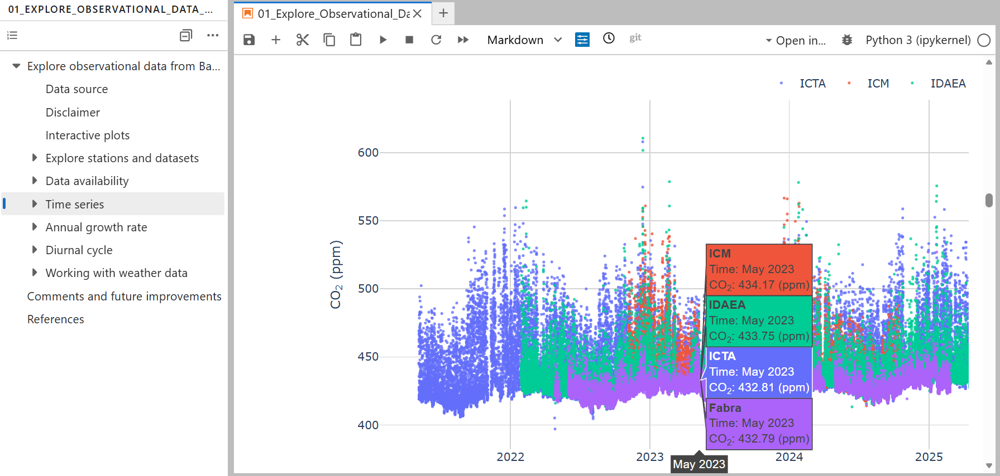
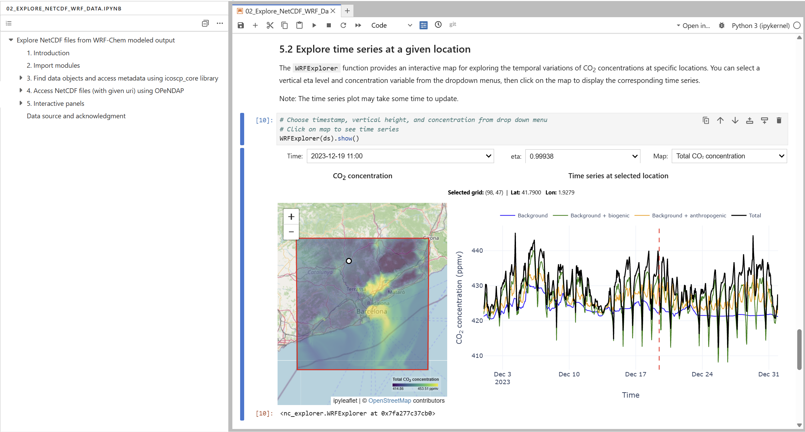
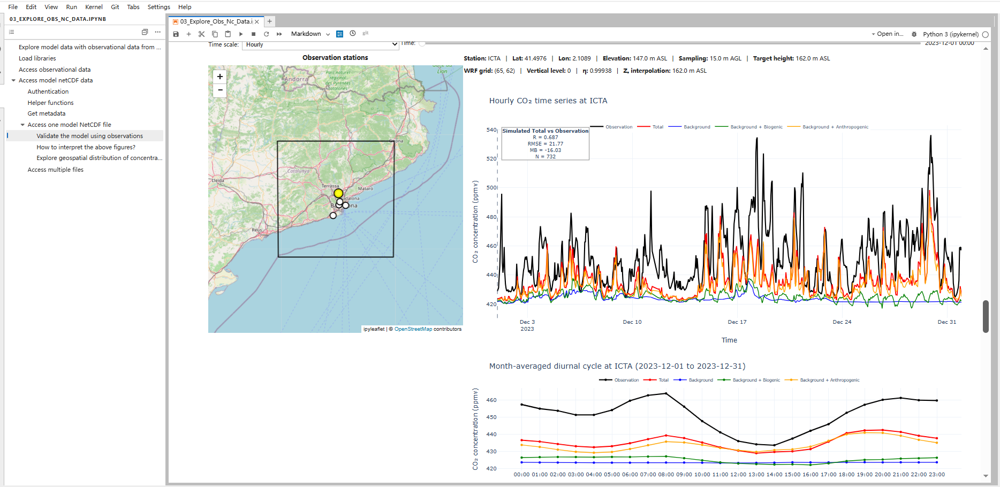

# Atmospheric Observations & Simulations Explorer for Cities: Metropolitan Area of Barcelona 

## Introduction

The [ICOS Cities](https://www.icos-cp.eu/projects/icos-cities) project (2021-2025; PAUL: Pilot Applications in Urban Landscapes) brought together European citizens, policy makers and top scientists in co-designing pioneer greenhouse gas measurement methodologies and services for cities to support climate action.

In three pilot cities, Paris, Munich and Zurich, ICOS Cities supported the set up an atmospheric monitoring infrastructure to measure greenhouse gas concentrations at city scale. This enabled these cities to move beyond estimation and into verifiable, data-driven climate action. Together with a city network, consisting of 12 additional European cities, Barcelona played a major role, with an urban greenhouse gas network established in early 2021, which is continuously maintained. 
   
The urban greenhouse gas monitoring network of the Metropolitan Area of Barcelona comprises five high-precision Picarro sites (Fabra, ICM, ICTA, IDAEA, and UPC-Agropolis) has been established in the Barcelona Metropolitan Area to track continuous CO2 and CH4 mole fractions. Strategically positioned across diverse land-use environments, ranging from natural forest and coastal zones to traffic-heavy corridors and agricultural areas, the network captures significant spatial and temporal variability, with forested sites showing lower concentration baselines and traffic-adjacent sites exhibiting pronounced morning peaks.

[Weather Research and Forecasting with chemistry (WRF-Chem) v4.3.3 model with greenhouse gas passive tracer option](https://www.bgc-jena.mpg.de/archived/bgc-systems/bgc-systems/uploads/Wrf-ghg/Technical%20Reports%202011%20Beck.pdf) are applied here to assess the source attribution of atmospheric CO₂ and quantify the contributions from biogenic and anthropogenic sources.The model was configured with three nested domains, with horizontal resolutions of 9, 3, and 1 km, respectively. Each domain comprised 45 vertical layers extending up to 50 hPa. Simulations covered the full year of 2023. Input emission inventories:(1) a high-resolution anthropogenic CO₂ emission inventory derived from the High-Elective Resolution Modelling Emission System delta version ([HERMES_∆](https://github.com/BSC-ES/HERMES_Delta))  and (2) biogenic CO₂ fluxes estimated using the Vegetation Photosyntheis and Respiration Model([VPRM](https://zenodo.org/records/10782550)). The initial and boundary condition data for the CO₂  concentrations were obtained from the [CAMS global inversion-optimised greenhouse gas fluxes and concentrations](https://ads.atmosphere.copernicus.eu/datasets/cams-global-greenhouse-gas-inversion?tab=overview)) 

Thus, these interactive Jupyter notebooks were created to provide an accessible, hands-on framework for exploring, visualizing, and comparing Barcelona’s atmospheric observational data (from the ICOS Cities [data portal](https://citydata.icos-cp.eu/portal/)) alongside urban transport modeling outputs. Designed as a practical reference tool, the notebooks aims to guide users through working with NetCDF files, analyzing spatial and temporal emission trends across diverse metropolitan land-use environments, and evaluating model against the atmospheric measurements. 

## Notebook 1: Explore observational data

This Jupyter Notebook provides a step-by-step workflow for importing and analyzing in-situ greenhouse gas (CO2, CH4) observations using ICOS Python tools. It imports datasets from ICOS Cities Data Portal and runs basic data analysis:
 - Station data: Connects to datasets across different stations from the same network (city), pulling key metadata like inlet heights, coordinates, and start/end of observations.
- Data Completeness: Checks data availability, missing values, and quality flags to ensure the time series is clean enough for analysis.
- Interactive plots: All plots are interactive and can be used to inspect continuous mole fractions, seasonal patterns, and short-term spikes. They include the possibility of comparing gases side-by-side, splitting day and night observations, examining diurnal cycles of mole fractions and enhanced mole fractions, and splitting by weekdays and weekends. 
- Merging Meteorology: Combines concentration data with local weather to filter mole fractions by wind sector and speed.

## Notebook 2: Explore NetCDF files from WRF-Chem modeled output

This notebook provides a basic introduction to reading, opening, exploring NetCDF data and related metadata. It retrieves and inspects the metadata associated with the data object from the ICOS Cities Data Portal. The users can then open the dataset and examine its structure and contents using the ``xarray`` library. Two additional interactive visualization tools can help further explore the model simulation results.

## Notebook 3: Validate model results with observational data

This notebook provides a hands-on workflow for evaluating and exploring WRF-Chem model results against observational data from Barcelona using ICOS Python libraries. It retrieves observational and model datasets from the ICOS Cities Data Portal, enabling users to compare simulated and observed atmospheric CO₂ concentrations and investigate the following aspects:

 - Model performance and reliability: Assess how well WRF-Chem reproduces observed CO₂ concentrations by comparing simulated and measured values, identifying discrepancies, and examining temporal variability.

 - Source attribution: Explore the contributions of different emission sources to simulated CO₂ concentration patterns and variability, helping to interpret the respective influences of anthropogenic and biogenic sources on urban atmospheric CO₂ concentrations.

## Additional documents

Scripts with the plotting functions that go along with the 01_Explore_Observations:
- obs_explorer.py
- weather_explorer.py

Scripts with the plotting functions that go along with the 02_Explore_NetCDF_WRF:
- nc_explorer.py

Scripts with the plotting functions that go along with the 03_Explore_Obs_NC:
- obs_nc_explorer.py

## References and contacts

**References for 01_Explore_Observations notebook**

- Mole fractions from in-situ stations in Barcelona, Spain: https://citydata.icos-cp.eu/portal/
- 'Working with weather data': publicly available data retrieved from the Barcelona–El Prat Airport weather station (accessed via Iowa Environmental Mesonet: https://mesonet.agron.iastate.edu/)
  
**References for 02_Explore_Obs_NC notebook and 03_Explore_Obs_NC notebook**

- Luo, Q., Monteiro, V., Villalba Mendez, G. (2026). WRF-Chem simulated atmospheric CO2 concentrations for Barcelona, December 2023, 2023-12-01–2023-12-31, ICOS Cities, https://hdl.handle.net/11676/LJ7II3ZiD4_YP_uVCuUKUmqk

- 'Shapefiles for AMB and Barcelona city boundary': publicly available data derived from Institut Cartogràfic i Geològic de Catalunya, https://www.icgc.cat/en/Geoinformation-and-Maps/Data-and-products/Cartographic-geoinformation/Administrative-boundaries

**Emails:**

- Vanessa Monteiro -  Vanessa.Monteiro@uab.cat
- Qing Luo - Qing.Luo@uab.cat
- Yi Wang - yi.wang@mgeo.lu.

**Websites**

- Greenhouse Gas (GHG) Monitoring Network of the Metropolitan Area of Barcelona (AMB): https://webs.uab.cat/atmosphere/greenhouse-gas-monitoring/
- Data Dashboard Greenhouse Gas (GHG) Monitoring Network of the Metropolitan Area of Barcelona (AMB): https://uab.maps.arcgis.com/apps/dashboards/84a00068ac834d428aac0fc1ebe52f47
- Atmospheric modelling of the Metropolitan Area of Barcelona (AMB): https://webs.uab.cat/atmosphere/atmospheric-modelling/
- ICOS Cities: https://www.icos-cp.eu/projects/icos-cities